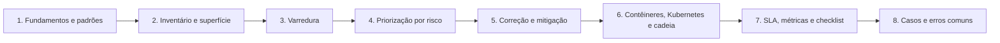

# 15 Gestão de Vulnerabilidades em Nuvem

## Objetivo

Estabelecer um programa contínuo e priorizado de gestão de vulnerabilidades para ambientes de nuvem: compreender os fundamentos e os padrões (CVE, CVSS, EPSS, KEV, SSVC, SBOM e VEX), manter o inventário de ativos como base, escolher e operar técnicas de varredura (com agentes, sem agentes, de imagens, de dependências e de código), priorizar por risco real e não apenas por gravidade, corrigir de forma eficiente com imagens imutáveis e aplicação de patches, tratar contêineres, Kubernetes, funções sem servidor e cadeia de suprimentos, e gerir prazos, exceções e indicadores.

## Trilha de estudo recomendada

## Conteúdo da pasta

| Ordem | Arquivo | Objetivo |
|---|---|---|
| 1 | [fundamentos-de-gestao-de-vulnerabilidades-em-nuvem.md](fundamentos-de-gestao-de-vulnerabilidades-em-nuvem.md) | Conceitos, padrões de identificação e de pontuação, ciclo de vida e responsabilidade compartilhada |
| 2 | [inventario-de-ativos-e-superficie-de-vulnerabilidades.md](inventario-de-ativos-e-superficie-de-vulnerabilidades.md) | Inventário de ativos efêmeros, SBOM, exposição e cobertura de varredura |
| 3 | [ferramentas-e-tecnicas-de-varredura-na-nuvem.md](ferramentas-e-tecnicas-de-varredura-na-nuvem.md) | Varredura com e sem agentes, imagens, dependências, código, IaC e segredos |
| 4 | [priorizacao-baseada-em-risco-cvss-epss-kev-e-ssvc.md](priorizacao-baseada-em-risco-cvss-epss-kev-e-ssvc.md) | CVSS v4.0, EPSS, KEV, SSVC, VEX e contexto de nuvem |
| 5 | [correcao-patching-imagens-imutaveis-e-mitigacoes.md](correcao-patching-imagens-imutaveis-e-mitigacoes.md) | Correção por reconstrução, patches, versões, fim de vida e correção emergencial |
| 6 | [conteineres-kubernetes-sem-servidor-e-cadeia-de-suprimentos.md](conteineres-kubernetes-sem-servidor-e-cadeia-de-suprimentos.md) | Imagens, clusters, funções, dependências, SBOM, VEX e admissão |
| 7 | [ciclo-de-vida-sla-excecoes-metricas-modelos-e-checklist.md](ciclo-de-vida-sla-excecoes-metricas-modelos-e-checklist.md) | Prazos, exceções, indicadores, análises com DuckDB, modelos e checklist |
| 8 | [casos-de-uso-e-erros-comuns-em-gestao-de-vulnerabilidades.md](casos-de-uso-e-erros-comuns-em-gestao-de-vulnerabilidades.md) | Casos fictícios, erros comuns, exercícios e perguntas de revisão |

## Princípios da pasta

- Não se corrige o que não se conhece: o inventário de ativos vem primeiro
- Gravidade não é risco: priorizar por exploração real, exposição, privilégios e criticidade
- Em nuvem, reconstruir e reimplantar é preferível a corrigir manualmente em produção
- Varredura contínua e integrada ao pipeline: a vulnerabilidade nasce no código e na imagem
- Prazos claros por prioridade, com exceções formais e mitigações enquanto não há correção
- Medir cobertura, tempo de exposição e reincidência, e não apenas contagens de achados

## Relação com outras pastas

- 02: responsabilidade compartilhada (quem corrige o quê)
- 03 e 04: governança e riscos
- 05 e 08: arquitetura e rede (redução de exposição)
- 12: controles e linha de base (gestão de patches e de vulnerabilidades)
- 13: monitoramento (detecção de exploração)
- 14: modelagem de ameaças (vulnerabilidades como pré-condições)
- 16 e 17: avaliações e gestão de postura
- 18 a 21: cargas de trabalho, contêineres, Kubernetes e DevSecOps
- 22: resposta a incidentes (exploração ativa)

## Referências

- Souppaya, M.; Scarfone, K. NIST SP 800-40 Rev. 4: Guide to Enterprise Patch Management Planning. 2022
- FIRST. Common Vulnerability Scoring System v4.0 e Exploit Prediction Scoring System (EPSS)
- CISA. Known Exploited Vulnerabilities Catalog e BOD 22-01; SSVC (CISA e Carnegie Mellon)
- ISO/IEC 27002:2022, controle 8.8; CIS Controls v8.1, controle 7; CSA CCM v4, domínio TVM
- SPDX e CycloneDX (SBOM); CycloneDX VEX, OpenVEX e CSAF (VEX)
