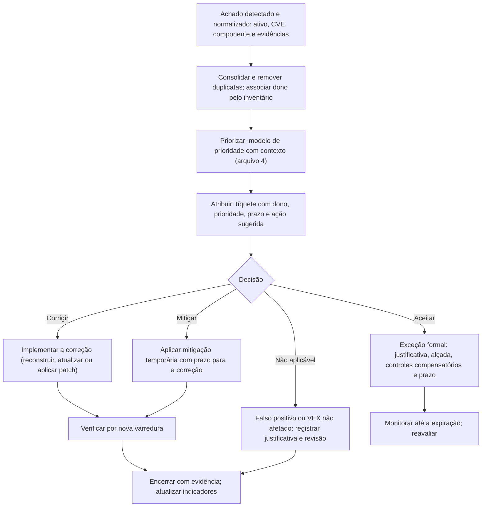

# Ciclo de Vida, SLA, Exceções, Métricas, Modelos e Checklist

> **Objetivo pedagógico:** operar o ciclo de vida de uma vulnerabilidade (do achado ao encerramento) com responsáveis, prazos (SLA) por prioridade e escalonamento; gerir exceções, aceitações e falsos positivos com rigor; definir indicadores de cobertura, de tempo, de risco e de eficácia; calcular os indicadores com DuckDB a partir de dados exportados; avaliar a maturidade do programa; e usar modelos (política, registro, exceção e relatório) e um checklist completo.

## 1. Ciclo de vida de um achado



## 2. Prazos (SLA) por prioridade

| Prioridade | Mitigação | Correção | Escalonamento se vencer |
|---|---|---|---|
| P0 | Imediata (horas) | Até 72 horas | Imediato à direção e ao líder de resposta |
| P1 | Até 48 horas, se não houver correção | Até 7 dias | Diretor da área e comitê de riscos |
| P2 | Quando aplicável | Até 30 dias | Gerente da área e segurança |
| P3 | Opcional | Até 90 dias | Líder da equipe |
| P4 | Não requerida | Próximo ciclo de manutenção ou aceitação documentada | Revisão trimestral |

| Boa prática | Descrição |
|---|---|
| Prazos contados a partir da **detecção** (ou da publicação, no caso de KEV) | Evita brechas por atraso de varredura |
| Prazos calibrados à capacidade e à regulação | Metas irreais geram contornos; consulte as normas setoriais |
| Pausas controladas | Congelamentos de mudanças justificados, com mitigação |
| Responsável e substituto | Evitar bloqueios por ausências |
| Escalonamento automático | Notificações a 50%, 80% e 100% do prazo |

## 3. Exceções, aceitações e falsos positivos

| Tipo | Quando | Requisitos |
|---|---|---|
| Falso positivo | A ferramenta reporta uma vulnerabilidade que não existe no ativo | Evidência da verificação; revisão por segundo avaliador; registro para ajustar a ferramenta |
| Não afetado (VEX) | O componente está presente, mas a vulnerabilidade não é explorável | Justificativa técnica (por exemplo, código não alcançável ou configuração que a neutraliza); revisão periódica |
| Aceitação de risco | Corrigir é inviável no prazo (dependência de fornecedor, impacto operacional ou ausência de correção) | Alçada por nível de risco, **controles compensatórios verificados**, prazo (máximo de 90 a 180 dias), plano de correção e monitoramento (pasta 12, arquivo 7; pasta 04, arquivo 5) |
| Adiamento operacional | Janela de mudança em data posterior | Mitigação até a janela; prazo curto |

Regras: **exceções expiram**; renovações exigem nova justificativa; vulnerabilidades KEV em ativos expostos têm **alçada mais alta** e prazos mais curtos; todas as exceções ficam em um **registro único**.

## 4. Indicadores

| Família | Indicador | Definição | Meta típica |
|---|---|---|---|
| Cobertura | Cobertura de varredura | Ativos varridos dentro do prazo ÷ ativos inventariados | Acima de 95% (críticos: 100%) |
| Cobertura | Ativos sem dono | Ativos sem proprietário | Zero |
| Tempo | Tempo médio de correção (MTTR) por prioridade | Da detecção ao encerramento verificado | Dentro do SLA |
| Tempo | Percentual dentro do SLA | Corrigidas no prazo ÷ total, por prioridade | Acima de 95% (P0 e P1: 100%) |
| Tempo | Janela de exposição de KEV | Dias entre a inclusão no KEV (ou a detecção) e a correção ou a mitigação | Horas a poucos dias |
| Risco | Vulnerabilidades abertas por prioridade | Contagem de P0, P1 e P2 abertas | P0 e P1 próximas de zero |
| Risco | KEV abertas em ativos expostos | Contagem | Zero |
| Risco | Vulnerabilidades vencidas | Além do SLA | Zero para P0 e P1 |
| Risco | Idade das vulnerabilidades abertas | Mediana e p90 de dias em aberto | Em redução |
| Eficácia | Reincidência | Vulnerabilidades corrigidas que reaparecem ÷ corrigidas | Abaixo de 5% |
| Eficácia | Percentual corrigido por reconstrução automática | Correções por pipeline ÷ total | Crescente |
| Eficácia | Incidentes por vulnerabilidades conhecidas e corrigíveis | Contagem | Zero |
| Qualidade | Falsos positivos | Achados descartados ÷ total triado | Em redução |
| Qualidade | Ativos em fim de vida | Ativos EOL ÷ total, por criticidade | Zero em críticos |
| Processo | Exceções ativas e vencidas | Contagem e idade | Vencidas: zero |
| Processo | Idade das imagens em produção | Dias desde a construção | Abaixo do limite da política |

Evite métricas de **vaidade** (por exemplo, o número bruto de achados): prefira métricas ligadas a **tempo de exposição** e a **risco**.

## 5. Cálculos com DuckDB

`vulnerabilidades.csv` (fictício):

```
id,cve,ativo,prioridade,abertura,fechamento,situacao,dono
V-001,CVE-2021-44228,vm-api-prod-01,P0,2026-11-10,2026-11-11,fechada,Plataforma
V-002,CVE-2023-00001,img-relatorios:2.1,P1,2026-11-01,2026-11-09,fechada,Dados
V-003,CVE-2024-00004,img-extratos:4.2,P1,2026-11-18,,aberta,Pagamentos
V-004,CVE-2022-00005,fn-pdf-gerador,P2,2026-10-05,,aberta,Pagamentos
V-005,CVE-2023-00006,vm-batch-02,P2,2026-11-12,2026-11-30,fechada,Operacoes
V-006,CVE-2025-00007,img-portal:7.0,P3,2026-08-15,,aberta,Portal
```

```sql
-- Prazos por prioridade (SLA em dias): P0=3, P1=7, P2=30, P3=90, P4=180
-- 1) Vulnerabilidades abertas vencidas (data de referência: 2026-11-27)
WITH sla AS (
  SELECT * FROM (VALUES ('P0',3),('P1',7),('P2',30),('P3',90),('P4',180)) AS t(prioridade, sla_dias)
)
SELECT v.id, v.cve, v.ativo, v.prioridade, v.dono,
       date_diff('day', CAST(v.abertura AS DATE), DATE '2026-11-27') AS dias_em_aberto,
       s.sla_dias,
       date_diff('day', CAST(v.abertura AS DATE), DATE '2026-11-27') - s.sla_dias AS dias_de_atraso
FROM read_csv_auto('vulnerabilidades.csv') v
JOIN sla s USING (prioridade)
WHERE v.situacao = 'aberta'
  AND date_diff('day', CAST(v.abertura AS DATE), DATE '2026-11-27') > s.sla_dias
ORDER BY v.prioridade, dias_de_atraso DESC;

-- 2) Percentual de vulnerabilidades fechadas dentro do SLA e tempo mediano de correção, por prioridade
WITH sla AS (
  SELECT * FROM (VALUES ('P0',3),('P1',7),('P2',30),('P3',90),('P4',180)) AS t(prioridade, sla_dias)
)
SELECT v.prioridade,
       count(*) AS fechadas,
       round(100.0 * count(*) FILTER (WHERE date_diff('day', CAST(v.abertura AS DATE), CAST(v.fechamento AS DATE)) <= s.sla_dias) / count(*), 1) AS percentual_no_prazo,
       median(date_diff('day', CAST(v.abertura AS DATE), CAST(v.fechamento AS DATE))) AS mediana_dias
FROM read_csv_auto('vulnerabilidades.csv') v
JOIN sla s USING (prioridade)
WHERE v.situacao = 'fechada'
GROUP BY v.prioridade
ORDER BY v.prioridade;
```

Os prazos e a data de referência são exemplos: use a sua política.

## 6. Maturidade do programa

| Nível | Descrição |
|---|---|
| 1 Inicial | Varreduras esporádicas; listas de achados sem dono; priorização por CVSS |
| 2 Repetível | Varreduras regulares; tíquetes e prazos; inventário parcial |
| 3 Definido | Inventário confiável; priorização com contexto (KEV e exposição); SLAs, exceções e indicadores; integração ao pipeline |
| 4 Gerenciado | Cobertura medida e alta; correção majoritariamente automatizada (imutabilidade); SBOM e VEX; indicadores de risco e de eficácia |
| 5 Otimizado | Modelos de priorização validados por dados; resposta emergencial testada; melhoria contínua; integração com modelagem de ameaças e com detecção |

## 7. Modelos

### 7.1 Política de gestão de vulnerabilidades (estrutura)

| Seção | Conteúdo |
|---|---|
| Objetivo e escopo | Ativos, ambientes, provedores e terceiros cobertos |
| Papéis e responsabilidades | Segurança, plataforma, equipes de produto, gestão de riscos e direção |
| Inventário e cobertura | Requisitos de inventário, de etiquetas e de varredura |
| Varredura | Técnicas, frequência, autorização e tratamento de resultados |
| Priorização | Modelo, insumos e prioridades |
| Prazos (SLA) e escalonamento | Tabela por prioridade |
| Correção e mitigação | Estratégias, correção emergencial e verificação |
| Exceções e aceitações | Critérios, alçadas, prazos e registro |
| Fim de vida | Inventário, alertas e planos |
| Cadeia de suprimentos | SBOM, VEX e requisitos para fornecedores |
| Indicadores e reporte | Métricas, periodicidade e destinatários |
| Revisão | Frequência e responsável |

### 7.2 Registro de vulnerabilidades

| ID | CVE e componente | Ativo e dono | Ambiente e exposição | CVSS | EPSS | KEV | Prioridade e motivo | Tratamento | Prazo | Situação | Evidência de encerramento |
|---|---|---|---|---|---|---|---|---|---|---|---|
| V-001 | | | | | | | | | | | |

### 7.3 Formulário de exceção de vulnerabilidade

| Campo | Preenchimento |
|---|---|
| ID da exceção, CVE e ativo | |
| Prioridade e justificativa da impossibilidade de correção no prazo | |
| Risco (probabilidade, impacto e exposição) | |
| Controles compensatórios (e como são verificados) | |
| Plano de correção, responsável e data alvo | |
| Alçada e aprovações (dono, segurança e comitê, conforme o nível) | |
| Prazo da exceção (máximo) e gatilhos de revisão (por exemplo, uso de exploração ativa) | |

### 7.4 Relatório mensal ao comitê (1 página)

| Seção | Conteúdo |
|---|---|
| Panorama | Cobertura de varredura; ativos sem dono; ativos em fim de vida |
| Risco | Vulnerabilidades P0 e P1 abertas e vencidas; KEV em ativos expostos |
| Tempo | Mediana de correção e percentual dentro do SLA, por prioridade |
| Eficácia | Reincidência; percentual de correção por reconstrução automática |
| Eventos | Vulnerabilidades críticas do mês e a resposta; incidentes relacionados |
| Exceções | Novas, ativas e vencidas |
| Decisões solicitadas | Recursos, prioridades e aceitações |
| Próximos passos | Prioridades do próximo mês |

## 8. Checklist de gestão de vulnerabilidades em nuvem

**Escopo:** ____________________
**Responsável:** ____________________
**Data:** ____________________

### 8.1 Estrutura

- [ ] Política aprovada, com escopo, papéis, priorização, prazos e exceções
- [ ] Responsabilidade por camada e por serviço definida (provedor, compartilhada ou cliente)
- [ ] Inventário de ativos e de componentes (SBOM) confiável, com dono, criticidade e exposição

### 8.2 Operação

- [ ] Varredura por camada (código, dependências, IaC, imagens, hosts, Kubernetes e funções) e reavaliação contínua
- [ ] Priorização com KEV, EPSS, CVSS e contexto de nuvem, com prioridade e motivo registrados
- [ ] Correção por infraestrutura imutável e gestão de patches com anéis; mitigações temporárias com prazo
- [ ] Fim de vida e versões de serviços gerenciados, clusters e ambientes de execução monitorados
- [ ] Processo emergencial (P0) definido e testado

### 8.3 Governança

- [ ] SLAs por prioridade com escalonamento automático
- [ ] Exceções com alçada, controles compensatórios verificados, prazo e registro único
- [ ] Indicadores de cobertura, de tempo, de risco e de eficácia reportados mensalmente
- [ ] Cadeia de suprimentos: SBOM e VEX exigidos de fornecedores e usados na resposta
- [ ] Revisão semestral do programa e do modelo de priorização

## 9. Resultado da verificação

| Resultado | Condição |
|---|---|
| Conforme | Todos os itens aplicáveis marcados |
| Conforme com ressalvas | Pendências sem P0 ou P1 vencidos, com plano de ação e prazos |
| Não conforme | KEV abertas em ativos expostos, P0 ou P1 vencidos sem exceção, ativos críticos sem cobertura de varredura ou sem inventário; corrigir com prioridade |

**Assinatura do responsável:** ____________________
**Assinatura do revisor:** ____________________

## 10. Exemplo prático: resultado de um ano de programa

| Indicador | Início | Após 12 meses |
|---|---|---|
| Cobertura de varredura | 78% | 98% |
| Ativos sem dono | 22% | 0% |
| Tempo mediano de correção de P0 e P1 | 19 dias | 3 dias |
| Percentual dentro do SLA (P0 e P1) | 41% | 97% |
| KEV abertas em ativos expostos | 14 | 0 |
| Percentual de correções por reconstrução automática | 12% | 74% |
| Reincidência | 17% | 4% |
| Exceções vencidas | 38 | 0 |
| Idade mediana das imagens em produção | 96 dias | 12 dias |
| Incidentes por vulnerabilidades conhecidas e corrigíveis | 3 | 0 |

## 11. Casos de uso corporativos

- Painel e relatório mensal de vulnerabilidades para a direção e para o comitê de riscos.
- Registro único de exceções com escalonamento automático e expiração.
- Evidências do programa para auditorias, reguladores e clientes.

## 12. Normas e frameworks relevantes

- NIST SP 800-40 Rev. 4; NIST SP 800-55 Rev. 1 (medição); ISO/IEC 27004:2016; ISO/IEC 27002:2022 (8.8)
- PCI DSS v4.0.1 (6.3 e 11.3); CIS Controls v8.1 (controle 7); CSA CCM v4 (TVM)
- ISO/IEC 29147 e 30111 (divulgação e tratamento de vulnerabilidades); normas setoriais aplicáveis

## 13. Referências

- Souppaya, M.; Scarfone, K. NIST SP 800-40 Rev. 4. 2022.
- Chew, E. et al. NIST SP 800-55 Rev. 1. 2008.
- ISO/IEC 29147:2018 e ISO/IEC 30111:2019.
- Documentação do DuckDB.
- Pastas 04, 12 e 27 deste repositório.
