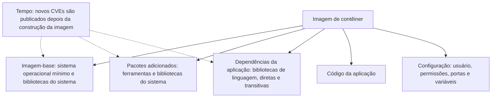

# Contêineres, Kubernetes, Funções Sem Servidor e Cadeia de Suprimentos

> **Objetivo pedagógico:** tratar as vulnerabilidades específicas de cargas modernas de nuvem: compreender as camadas de uma imagem de contêiner e onde nascem as vulnerabilidades, varrer imagens no pipeline e nos registros com reavaliação contínua, impor critérios com políticas de admissão no cluster (por exemplo, proibir a etiqueta `latest` e exigir imagens assinadas), tratar vulnerabilidades de componentes do Kubernetes e dos nós, gerir dependências e ambientes de execução de funções sem servidor, usar SBOM e VEX na cadeia de suprimentos e distinguir componentes vulneráveis de componentes maliciosos.

## 1. Onde nascem as vulnerabilidades em contêineres



| Camada | Origem | Responsável | Controle |
|---|---|---|---|
| Imagem-base | Distribuição ou imagem oficial | Plataforma | Imagens mínimas, atualizadas e verificadas |
| Pacotes do sistema | Instalados no Dockerfile | Equipe da aplicação | Instalar apenas o necessário; remover ferramentas de construção |
| Dependências da aplicação | Gerenciadores de pacotes de linguagens | Equipe da aplicação | SCA, atualização automática, fixação de versões |
| Código | Equipe da aplicação | Equipe da aplicação | SAST, revisão de código |
| Configuração | Dockerfile e manifestos | Equipe da aplicação e plataforma | Usuário sem privilégios, sistema de arquivos somente leitura |

## 2. Varredura e reavaliação contínua de imagens

| Momento | Técnica | Decisão |
|---|---|---|
| Construção | Varredura da imagem e geração de SBOM no pipeline | Bloquear por critérios (arquivo 3) |
| Publicação no registro | Varredura no envio e varredura contínua no registro | Alertar e abrir tíquetes quando surgirem novos CVEs |
| Implantação | Verificação de assinatura e de critérios por política de admissão | Negar imagens que não cumprem |
| Execução | Varredura das imagens em uso e inventário do que roda no cluster | Priorizar o que está implantado e exposto |
| Substituição | Reconstrução e reimplantação com imagem corrigida | Fechar o tíquete após a verificação |

**Ponto-chave:** o resultado de uma varredura **expira**: uma imagem limpa hoje pode estar vulnerável amanhã. A **reavaliação contínua** das imagens no registro e em execução é obrigatória, com **ciclo de vida de imagens** (remover imagens antigas e não usadas).

### Políticas de idade e de uso de imagens

| Política | Descrição |
|---|---|
| Idade máxima da imagem em produção | Por exemplo, reconstruir ao menos a cada 30 dias, mesmo sem mudanças no código |
| Imagens-base aprovadas | Apenas de fontes aprovadas e atualizadas pela plataforma |
| Proibição de etiquetas mutáveis | Usar resumos (digests) ou versões fixas |
| Remoção de imagens não usadas | Limpeza periódica do registro |

## 3. Políticas de admissão no Kubernetes

Os controladores de admissão avaliam cada objeto antes de ser aceito pelo cluster, impedindo cargas que violem os critérios.

### Exemplo: política Kyverno que proíbe a etiqueta `latest`

```yaml
apiVersion: kyverno.io/v1
kind: ClusterPolicy
metadata:
  name: proibir-tag-latest
spec:
  validationFailureAction: Enforce
  background: true
  rules:
    - name: exigir-tag-fixa
      match:
        any:
          - resources:
              kinds:
                - Pod
      validate:
        message: "Use uma versão fixa ou, preferencialmente, o resumo (digest) da imagem; a etiqueta 'latest' é proibida."
        pattern:
          spec:
            containers:
              - image: "!*:latest"
```

Implante primeiro com `validationFailureAction: Audit` para medir o impacto e só então imponha (`Enforce`). Outras políticas de admissão úteis:

| Política | Objetivo |
|---|---|
| Exigir imagens de registros aprovados | Evitar imagens de origens desconhecidas |
| Exigir imagens assinadas (verificação de assinaturas) | Garantir origem e integridade (pasta 10, arquivo 5) |
| Negar contêineres privilegiados e execução como administrador | Reduzir o impacto da exploração (pasta 20) |
| Exigir limites de recursos | Evitar abuso e esgotamento |
| Exigir sistema de arquivos de raiz somente leitura | Dificultar persistência |
| Negar imagens com vulnerabilidades críticas corrigíveis (quando o ecossistema suporta atestações de varredura) | Impor o critério na implantação |

Alternativas e complementos: Pod Security Admission, ValidatingAdmissionPolicy (nativo do Kubernetes), OPA Gatekeeper e autorização binária no GKE.

## 4. Vulnerabilidades do Kubernetes e dos nós

| Componente | Origem de vulnerabilidades | Tratamento |
|---|---|---|
| Plano de controle (servidor de API e outros) | Versões do Kubernetes e de componentes | Em serviços gerenciados: manter versões suportadas e atualizar dentro das janelas; avisos do provedor |
| Nós (sistema operacional, kubelet e tempo de execução de contêineres) | Pacotes e componentes do nó | Imagens de nós atualizadas e substituição progressiva (imutabilidade dos nós) |
| Componentes complementares (controladores de ingresso, malhas de serviços e operadores) | Versões e configurações | Inventário, varredura e atualização |
| Configuração insegura | RBAC amplo, painéis expostos e contêineres privilegiados | Benchmarks e verificação contínua (pasta 20) |
| Fim de suporte de versões | Versões antigas sem correções | Calendário de atualizações do cluster |

```bash
# Varredura do cluster (imagens em execução, configurações e componentes) com Trivy, com resumo (somente leitura; exige acesso ao cluster)
trivy k8s --report summary cluster

# Verificação do nó contra o CIS Kubernetes Benchmark com kube-bench (execute no nó, com autorização)
kube-bench run --targets node
```

Os comandos são exemplos de ferramentas de código aberto: confirme a sintaxe, as versões e as permissões necessárias.

## 5. Funções sem servidor

| Aspecto | Descrição | Controle |
|---|---|---|
| Dependências do pacote | Bibliotecas incluídas na função | SCA no pipeline e atualização automática |
| Camadas compartilhadas | Bibliotecas compartilhadas por várias funções | Inventário de camadas e funções que as usam; atualização coordenada |
| Ambiente de execução | Versão da linguagem fornecida pelo provedor, com datas de descontinuação | Inventário de ambientes de execução e plano de migração antes do fim do suporte |
| Código | Falhas de implementação | SAST, revisão e testes |
| Imagens de contêineres de funções | Imagens usadas como pacote | Mesmas práticas de imagens |
| Permissões | Papel da função | Privilégio mínimo (pasta 18) |
| Visibilidade | Ativos efêmeros, sem host | Varredura de pacotes e de funções por serviços nativos; inventário de funções |

Os provedores publicam **calendários de descontinuação** dos ambientes de execução: uma função em ambiente descontinuado deixa de receber correções e, eventualmente, de poder ser atualizada. Trate-as como **vulnerabilidades de fim de vida** (arquivo 5).

## 6. Cadeia de suprimentos de software

### 6.1 Vulnerável versus malicioso

| Tipo | Descrição | Resposta |
|---|---|---|
| Componente vulnerável | Contém uma falha acidental e conhecida; é o caso dos CVEs | Gestão de vulnerabilidades: priorizar, atualizar ou mitigar |
| Componente malicioso | Criado ou adulterado para causar dano (pacote malicioso, *typosquatting* e confusão de dependências) | Prevenção e resposta a incidentes: bloquear, remover e investigar (pasta 14, arquivo 4) |
| Componente abandonado | Sem manutenção; sem correções futuras | Substituir; avaliar o risco |

### 6.2 Controles da cadeia de suprimentos

| Controle | Descrição |
|---|---|
| SBOM por artefato | Inventário de componentes, assinado e associado ao artefato (arquivo 2) |
| VEX | Declarações de explorabilidade para reduzir ruído (arquivo 4) |
| Fixação de versões e de resumos | Dependências e imagens fixadas; atualizações por *pull request* revisado |
| Repositórios internos como fonte única | Espelhamento e controle de pacotes; reserva de nomes internos |
| Verificação de integridade e de proveniência | Assinaturas e atestações de construção (por exemplo, com níveis SLSA) |
| Revisão de novas dependências | Avaliar a manutenção, a reputação e a necessidade antes de adotar |
| Atualização automática controlada | Ferramentas como Dependabot e Renovate, com testes automatizados |
| Pipelines protegidos | Permissões mínimas e ações de terceiros fixadas (pasta 21) |
| Monitoramento de avisos | Alertas para componentes usados (bases abertas, como OSV) |

## 7. SBOM e VEX na prática

| Fluxo | Descrição |
|---|---|
| Construção | O pipeline gera a SBOM da imagem e a assina junto à imagem |
| Registro | A SBOM é armazenada com a imagem (por exemplo, como atestação associada) |
| Consulta | Quando um CVE é divulgado, consultar as SBOM armazenadas para identificar as imagens afetadas, sem nova varredura completa |
| Reavaliação contínua | Cruzar periodicamente as SBOM com as bases de vulnerabilidades |
| VEX | Registrar, por produto, quando um componente presente não é explorável; comunicar a clientes, se for o caso |
| Fornecedores | Exigir SBOM e VEX de fornecedores de software e de imagens (pasta 11, arquivo 7) |

## 8. Exemplo prático: programa para 300 serviços em contêineres e 120 funções

| Elemento | Decisão |
|---|---|
| Imagens-base | Duas imagens-base aprovadas (mínimas), reconstruídas semanalmente pela plataforma; serviços reconstruídos automaticamente |
| Construção | Varredura, SBOM e assinatura no pipeline; bloqueio por vulnerabilidades altas ou críticas corrigíveis |
| Registro | Reavaliação diária das imagens; alerta a equipes com novas vulnerabilidades; remoção de imagens com mais de 90 dias sem uso |
| Cluster | Política de admissão (imagens assinadas, registros aprovados, sem `latest` e sem privilégios), inicialmente em auditoria por 4 semanas e depois imposta |
| Nós | Imagens de nós substituídas mensalmente; atualização de versões do cluster conforme o calendário do provedor |
| Funções | Inventário de ambientes de execução e de camadas; alertas a 6 e 3 meses antes da descontinuação; atualização de dependências por *pull requests* automáticos |
| Cadeia de suprimentos | Repositório interno de pacotes; fixação de resumos; revisão de novas dependências; exigência de SBOM de fornecedores |
| Resultado | Idade mediana das imagens em produção de 74 para 11 dias; 92% das vulnerabilidades altas e críticas corrigidas por reconstrução automática; nenhuma função em ambiente de execução descontinuado | |

## 9. Casos de uso corporativos

- Esteira de imagens com varredura, SBOM, assinatura e reavaliação contínua em registros.
- Políticas de admissão no Kubernetes alinhadas à linha de base de controles.
- Programa de atualização de dependências e de ambientes de execução de funções.

## 10. Normas e frameworks relevantes

- NIST SP 800-190 (guia de segurança de contêineres de aplicações); NIST SP 800-204 (série, microsserviços); NIST SP 800-218 (SSDF); NIST SP 800-161 Rev. 1 (cadeia de suprimentos)
- CIS Docker e Kubernetes Benchmarks; SLSA (níveis de proveniência); NTIA (elementos mínimos de SBOM); OpenSSF (Scorecard e práticas)
- OWASP Top 10 CI/CD Security Risks; ISO/IEC 27002:2022 (8.8 e 5.21, gestão da segurança da informação na cadeia de suprimentos de TIC); CSA CCM v4 (TVM e STA)

## 11. Checklist operacional: contêineres, funções e cadeia de suprimentos

- [ ] Imagens-base aprovadas, mínimas e atualizadas regularmente; reconstrução automática de dependentes
- [ ] Varredura e SBOM na construção; reavaliação contínua de imagens em registros e em execução
- [ ] Idade máxima de imagens em produção e limpeza de imagens antigas
- [ ] Políticas de admissão no cluster (imagens aprovadas e assinadas, sem `latest`, sem privilégios), introduzidas em auditoria e depois impostas
- [ ] Versões de clusters e de nós atualizadas dentro do suporte; varredura de configuração do cluster
- [ ] Inventário de funções, de camadas e de ambientes de execução; alertas de descontinuação
- [ ] Dependências fixadas e atualizadas por processo controlado; repositório interno como fonte
- [ ] Distinção entre componentes vulneráveis e maliciosos nos processos de resposta
- [ ] SBOM e VEX exigidos de fornecedores e usados em respostas a novos CVEs
- [ ] Revisão trimestral das políticas e dos indicadores

## 12. Referências

- Souppaya, M. et al. NIST SP 800-190: Application Container Security Guide. 2017.
- CIS. CIS Kubernetes Benchmark e CIS Docker Benchmark.
- Kyverno; Open Policy Agent Gatekeeper; Kubernetes. Pod Security Admission e ValidatingAdmissionPolicy (documentação).
- SLSA (slsa.dev); OpenSSF Scorecard; Sigstore (documentação).
- Pastas 10, 14, 19, 20 e 21 deste repositório.
