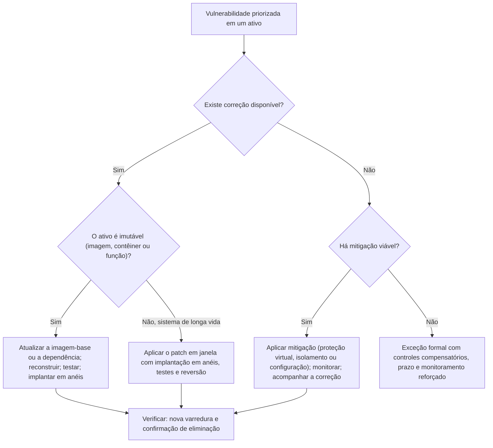
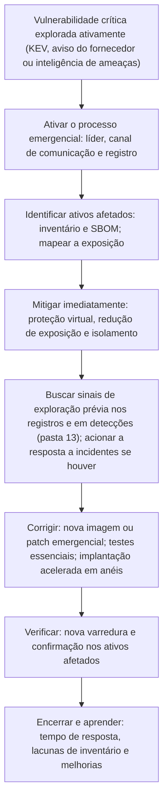

# Correção, Patching, Imagens Imutáveis e Mitigações

> **Objetivo pedagógico:** corrigir vulnerabilidades de forma eficiente e segura em nuvem: preferir a **infraestrutura imutável** (reconstruir e reimplantar imagens) à correção manual em instâncias, manter pipelines de imagens padronizadas, gerir patches de sistemas de longa vida com janelas e implantação em anéis, tratar versões de serviços gerenciados, de clusters e de ambientes de execução de funções, gerir o fim de vida, aplicar mitigações e proteção virtual quando não há correção imediata, conduzir a correção emergencial e verificar a eliminação.

## 1. Estratégias de correção

| Estratégia | Descrição | Quando usar |
|---|---|---|
| Atualizar o componente (patch ou nova versão) | Aplicar a versão corrigida | Padrão |
| Reconstruir e reimplantar (infraestrutura imutável) | Construir nova imagem com as correções e substituir as instâncias, em vez de alterar em produção | **Preferida** em nuvem para contêineres, funções e instâncias gerenciadas por modelos |
| Substituir o componente | Trocar por alternativa sem a falha | Componentes sem manutenção |
| Mitigar | Reduzir a exploração sem eliminar a falha (regra de proteção, isolamento e configuração) | Enquanto não há correção, ou até a janela de mudança |
| Remover ou desativar | Eliminar o recurso vulnerável desnecessário | Funcionalidades não usadas |
| Aceitar (exceção) | Reter o risco, com justificativa, alçada e prazo | Quando nenhuma das anteriores é viável (arquivo 7) |



## 2. Infraestrutura imutável

| Princípio | Prática |
|---|---|
| Não alterar instâncias em produção | Alterações ocorrem no código (imagem e infraestrutura como código), e não por acesso manual |
| Imagens padronizadas (*golden images*) | Imagens-base mantidas pela plataforma, endurecidas e atualizadas regularmente |
| Pipeline de construção de imagens | Construção automatizada, com varredura, testes, assinatura e publicação (por exemplo, com ferramentas como o EC2 Image Builder e o Packer) |
| Imagens mínimas | Menos componentes, menos vulnerabilidades (por exemplo, imagens mínimas ou *distroless* para contêineres) |
| Atualizações frequentes das imagens-base | Ciclo automático (por exemplo, semanal) e reconstrução de dependentes |
| Substituição em vez de correção | Novas instâncias com a imagem corrigida; as antigas são descartadas |
| Reversão simples | Manter a imagem anterior disponível para reversão rápida |
| Sem acesso interativo | Acesso administrativo por exceção e por sessões gerenciadas (pasta 06) |

### Vantagens

| Vantagem | Descrição |
|---|---|
| Consistência | Todas as instâncias idênticas, sem desvios de configuração |
| Velocidade | Corrigir a imagem corrige todas as instâncias após a reimplantação |
| Rastreabilidade | Cada versão de imagem tem SBOM, varredura e assinatura |
| Menor superfície | Sem ferramentas desnecessárias e sem acesso manual |

### Exemplo: boas práticas de Dockerfile para reduzir vulnerabilidades

```dockerfile
# Etapa de construção: contém compiladores e ferramentas que não irão para produção
FROM docker.io/library/golang:1.23 AS construcao
WORKDIR /app
COPY go.mod go.sum ./
RUN go mod download
COPY . .
RUN CGO_ENABLED=0 go build -o /app/servico ./cmd/servico

# Etapa final: imagem mínima, sem shell nem gerenciador de pacotes, executando sem privilégios
# Para reproduzibilidade, fixe a imagem-base pelo resumo (digest): FROM gcr.io/distroless/static-debian12@sha256:<RESUMO>
FROM gcr.io/distroless/static-debian12:nonroot
COPY --from=construcao /app/servico /servico
USER nonroot:nonroot
ENTRYPOINT ["/servico"]
```

O exemplo é ilustrativo: os nomes e as versões das imagens mudam. **Fixe pelo resumo (digest)**, atualize de forma controlada e reconstrua quando a imagem-base receber correções.

## 3. Gestão de patches em sistemas de longa vida

Nem todo sistema é imutável (por exemplo, servidores com estado, aplicações legadas e dispositivos virtuais de terceiros). Para esses, aplique práticas de gestão de patches (NIST SP 800-40 Rev. 4):

| Prática | Descrição |
|---|---|
| Agrupar ativos por grupos de manutenção | Por criticidade, por aplicação e por janela de manutenção |
| Janelas de manutenção definidas | Com comunicação e aprovação |
| Implantação em anéis | Primeiro um grupo de teste, depois um grupo canário, depois a produção em fases |
| Testes antes da produção | Ambiente de homologação e verificação funcional |
| Reversão | Plano de retorno ao estado anterior (instantâneo ou imagem) |
| Automação | Ferramentas de gestão de patches dos provedores |
| Verificação pós-patch | Nova varredura e validação da aplicação |
| Registro | Evidência do que foi aplicado, quando e por quem |
| Reinicializações | Planejamento de reinícios necessários e de disponibilidade |
| Patches de segurança versus de funcionalidade | Separar, quando possível, para acelerar correções de segurança |

| Provedor | Ferramenta de gestão de patches (categoria) |
|---|---|
| AWS | Systems Manager Patch Manager, com linhas de base de patches, janelas de manutenção e relatórios de conformidade |
| Azure | Azure Update Manager (avaliação e implantação de atualizações de máquinas virtuais e de servidores híbridos) |
| Google Cloud | VM Manager (gestão de patches do sistema operacional, com implantações programadas) |

```bash
# AWS: estado de aplicação de patches das instâncias e linhas de base existentes (somente leitura)
aws ssm describe-instance-patch-states --instance-ids i-0123456789abcdef0 \
  --query "InstancePatchStates[].[InstanceId,InstalledCount,MissingCount,FailedCount,OperationEndTime]" --output table
aws ssm describe-patch-baselines --query "BaselineIdentities[].[BaselineName,OperatingSystem,DefaultBaseline]" --output table

# Google Cloud: implantações de patches programadas no VM Manager (somente leitura)
gcloud compute os-config patch-deployments list --format="table(name,lastExecuteTime,state)"
```

## 4. Serviços gerenciados, clusters e funções

| Elemento | Responsabilidade e ação |
|---|---|
| Bancos de dados gerenciados | O provedor corrige a plataforma; o cliente escolhe versões do motor, janelas de manutenção e a adoção de atualizações menores automáticas; gerir fim de suporte (alguns provedores cobram suporte estendido para versões antigas) |
| Clusters Kubernetes gerenciados | O provedor atualiza o plano de controle gerenciado dentro das versões suportadas; o cliente atualiza **versões do cluster e dos nós** antes do fim de suporte, e as imagens das cargas |
| Nós de clusters | Atualização de imagens de nós e substituição progressiva |
| Funções sem servidor | O provedor corrige o ambiente de execução; o cliente atualiza o **código, as dependências, as camadas e a versão do ambiente de execução** antes de sua descontinuação |
| Serviços de contêineres sem servidor | O provedor corrige a infraestrutura; o cliente reconstrói as imagens |
| Dispositivos virtuais de terceiros | Atualizações do fabricante, com janelas e testes |
| Avisos do provedor | Acompanhar comunicados de segurança e de descontinuação (pasta 13, arquivo 6) |

## 5. Gestão de fim de vida (EOL)

Componentes em fim de vida **deixam de receber correções de segurança**: tornam-se vulnerabilidades permanentes.

| Prática | Descrição |
|---|---|
| Inventário de versões | Sistemas operacionais, motores de bancos, versões de clusters, ambientes de execução e bibliotecas, com datas de fim de suporte |
| Fontes de datas | Calendários dos fornecedores e dos provedores e catálogos públicos de ciclos de vida de produtos |
| Alertas antecipados | Alerta 12, 6 e 3 meses antes do fim do suporte |
| Plano de migração | Prazo, responsável e orçamento por ativo |
| Tratamento do que não pode ser migrado | Isolamento, controles compensatórios, suporte estendido pago e exceção formal com prazo |
| Indicador | Ativos em fim de vida ÷ total, por criticidade |

## 6. Mitigações e proteção virtual

Quando não há correção disponível, ou até que a janela chegue, reduza a exploração:

| Mitigação | Descrição | Exemplos |
|---|---|---|
| Proteção virtual na borda | Regras de WAF que bloqueiam o padrão de exploração | Regras específicas para o CVE; regras gerenciadas atualizadas |
| Redução de exposição | Remover o acesso público ou restringir origens | Fechar portas; acesso privado (pasta 08) |
| Isolamento e segmentação | Limitar o alcance do ativo | Regras de rede restritas; segmento dedicado |
| Desabilitar recurso vulnerável | Configuração que elimina o caminho de exploração | Parâmetros do fornecedor, recomendados em avisos |
| Permissões mínimas | Reduzir o impacto da exploração | Papel da carga com permissões mínimas |
| Detecção reforçada | Alertas e caça para sinais de exploração | Detecções específicas (pasta 13) |
| Segredos e credenciais | Rotação preventiva de credenciais acessíveis ao ativo | Pasta 06 |
| Backup e recuperação | Garantir a capacidade de recuperação | Pasta 09 |

**Atenção:** mitigações são **temporárias**; registre prazos e acompanhe a correção. A proteção virtual **não** garante a eliminação de variações de exploração.

## 7. Correção emergencial (P0)



| Elemento | Prática |
|---|---|
| Responsável e comunicação | Líder designado, canal único e atualização periódica à direção |
| Prazos | Mitigação em horas; correção em até 72 horas (exemplo) |
| Mudança emergencial | Fluxo acelerado, com aprovação reduzida e registro posterior |
| Investigação de comprometimento | Quando há exploração ativa, assumir que ativos expostos podem ter sido atacados antes da correção: verificar |
| Comunicação externa | Clientes, reguladores e parceiros, quando houver impacto (pasta 11, arquivo 6) |

## 8. Verificação da correção

| Verificação | Descrição |
|---|---|
| Nova varredura | Confirmar que a vulnerabilidade não é mais detectada no ativo |
| Verificação de implantação | Confirmar que todas as instâncias usam a imagem corrigida (por resumo) |
| Testes funcionais | A aplicação continua operando |
| Atualização do inventário e do SBOM | Versões atuais registradas |
| Encerramento do tíquete com evidência | Resultado da varredura e da implantação |
| Monitoramento de recorrência | Verificar que a vulnerabilidade não retorna (por exemplo, por reimplantação de uma imagem antiga) |

## 9. Exemplo prático: resposta a uma vulnerabilidade crítica em uma biblioteca amplamente usada

| Hora | Ação |
|---|---|
| H+0 | A divulgação é classificada como P0 (KEV e exposta); o processo emergencial é ativado |
| H+1 | O inventário de componentes identifica 214 imagens e 37 máquinas virtuais com a biblioteca; 9 serviços expostos à internet |
| H+2 | Mitigação: regras de proteção virtual na borda e parâmetro de configuração do fornecedor aplicado aos serviços expostos |
| H+4 | Busca de sinais de exploração nos registros: 2 tentativas bloqueadas, sem comprometimento |
| H+10 | Atualização da biblioteca no pipeline; reconstrução automática das imagens dependentes |
| H+20 | Implantação em anéis dos 9 serviços expostos; verificação por nova varredura |
| H+36 | Todos os serviços de produção corrigidos; máquinas virtuais remanescentes com patch em janela de emergência |
| D+5 | Retrospectiva: o inventário e a SBOM reduziram a identificação de dias para 1 hora; ações para 3 sistemas legados sem SBOM |

## 10. Casos de uso corporativos

- Pipeline de imagens padronizadas, com varredura, assinatura e atualização regular das imagens-base.
- Programa de gestão de patches para sistemas de longa vida, com anéis e janelas.
- Gestão de fim de vida e de versões de serviços gerenciados, clusters e ambientes de execução.

## 11. Normas e frameworks relevantes

- NIST SP 800-40 Rev. 4 (gestão de patches); NIST SP 800-53 Rev. 5 (SI-2, correção de falhas; CM-3, controle de mudanças); NIST SP 800-218 (SSDF: RV.2, tratar vulnerabilidades)
- ISO/IEC 27002:2022 (8.8, gestão de vulnerabilidades técnicas; 8.32, gestão de mudanças); CIS Controls v8.1 (controles 4 e 7); CSA CCM v4 (TVM e CCC)
- PCI DSS v4.0.1 (6.3.3, instalar patches de segurança em prazos definidos)

## 12. Checklist operacional: correção e mitigação

- [ ] Estratégia de infraestrutura imutável adotada; pipeline de imagens padronizadas, endurecidas, assinadas e atualizadas regularmente
- [ ] Gestão de patches para sistemas de longa vida, com grupos, janelas, anéis, testes e reversão
- [ ] Versões de serviços gerenciados, de clusters e de ambientes de execução inventariadas e atualizadas antes do fim do suporte
- [ ] Inventário e alertas de fim de vida, com planos de migração e exceções formais
- [ ] Mitigações e proteção virtual aplicáveis, temporárias e com prazo para a correção
- [ ] Processo de correção emergencial (P0) definido, testado e com investigação de exploração prévia
- [ ] Verificação da correção por varredura e por confirmação de implantação, com evidências
- [ ] Monitoramento de recorrência (reimplantação de imagens antigas)
- [ ] Revisão semestral dos processos e das imagens-base

## 13. Referências

- Souppaya, M.; Scarfone, K. NIST SP 800-40 Rev. 4. 2022.
- Amazon Web Services. Systems Manager Patch Manager e EC2 Image Builder; Microsoft. Azure Update Manager; Google Cloud. VM Manager (documentação vigente).
- HashiCorp. Packer (documentação); Google. Distroless Container Images (documentação).
- CISA. Orientações de resposta a vulnerabilidades exploradas (documentação).
- Pastas 05, 12, 13 e 21 deste repositório.
