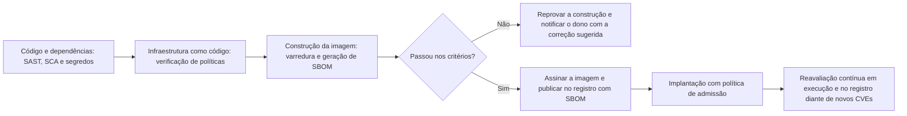

# Ferramentas e Técnicas de Varredura na Nuvem

> **Objetivo pedagógico:** conhecer e escolher as técnicas de varredura de vulnerabilidades em nuvem (com agentes, sem agentes por instantâneos, de rede, autenticada e não autenticada, de imagens de contêineres, de dependências, de código, de infraestrutura como código, de segredos e de Kubernetes), entender seus limites e custos, operá-las com segurança (autorização, impacto, credenciais e dados dos resultados), integrá-las ao pipeline de entrega e comparar as ofertas nativas dos provedores com ferramentas de código aberto e comerciais.

> **Segurança e autorização:** execute varreduras apenas em ativos **próprios ou autorizados** e conforme as políticas do provedor e dos fornecedores. Varreduras podem causar carga ou instabilidade: teste primeiro em ambientes não produtivos e defina janelas e limites.

## 1. Técnicas de varredura

| Técnica | O que analisa | Vantagens | Limitações |
|---|---|---|---|
| Com agentes | Software e configuração do host, a partir do próprio host | Visão detalhada e contínua; funciona em redes isoladas | Exige instalação e manutenção; consumo de recursos; lacunas quando o agente falha |
| Sem agentes (por instantâneos) | Cópia do disco de uma instância analisada fora dela | Sem instalação; cobertura ampla e rápida; sem impacto na carga | Visão do momento do instantâneo; custos; limitações em alguns sistemas e em dados efêmeros |
| De rede (autenticada) | Serviços e pacotes por acesso com credenciais | Visão precisa de pacotes e de configurações | Gestão de credenciais; carga na rede e nos sistemas |
| De rede (não autenticada) | Serviços expostos, versões e falhas visíveis de fora | Simula a visão do atacante; útil para a superfície externa | Falsos positivos e negativos; visão limitada |
| De imagens de contêineres | Camadas, pacotes e dependências da imagem | Shift-left; corrige a origem; escala | Não vê o estado de execução; precisa de reavaliação contínua |
| De dependências (SCA) | Bibliotecas e transitivos de aplicações | Detecta componentes vulneráveis no código | Falsos positivos por componentes não alcançáveis |
| De código (SAST) | Código-fonte da aplicação | Falhas de implementação no início do ciclo | Falsos positivos; cobertura limitada de lógica |
| Dinâmica de aplicações (DAST) | Aplicação em execução, por requisições | Verifica a explorabilidade externa | Necessita de ambiente e de autenticação; cobertura limitada |
| De infraestrutura como código | Modelos de recursos | Impede configurações inseguras antes da implantação | Regras genéricas; contexto limitado |
| De segredos | Repositórios, imagens e registros | Evita exposição de credenciais | Falsos positivos; necessidade de rotação quando detectados |
| De Kubernetes | Cluster, nós e cargas (configurações e imagens) | Visão do ambiente de orquestração | Dependência de versões e de permissões |
| De funções sem servidor | Código, camadas, dependências e ambiente de execução | Cobre um ativo sem host | Dependente do suporte da ferramenta |

**Combine técnicas:** nenhuma, isolada, cobre todo o espectro. A abordagem eficaz é **varrer cedo (código, dependências e imagens), continuamente em execução (agentes ou sem agentes) e de fora (superfície externa)**.

## 2. Oferta nativa dos provedores (categorias)

| Capacidade | AWS | Azure | Google Cloud |
|---|---|---|---|
| Hosts (agente e sem agente) | Amazon Inspector (EC2, com agente via Systems Manager e varredura sem agente) | Defender for Cloud com gestão de vulnerabilidades (inclui varredura sem agente) | Relatórios de vulnerabilidades do VM Manager; Security Command Center |
| Imagens em registros | Varredura aprimorada do ECR pelo Inspector | Defender for Containers (varredura de imagens no ACR e em execução) | Artifact Analysis (varredura de imagens no Artifact Registry) |
| Funções sem servidor | Inspector (varredura de dependências e de código de funções) | Defender for App Service e recursos de varredura de funções | Varredura de dependências por Artifact Analysis e ferramentas de código |
| Kubernetes | Inspector para imagens; EKS com serviços de segurança | Defender for Containers | Security Command Center e GKE Security Posture |
| Painel e achados | Security Hub | Defender for Cloud | Security Command Center |
| Atualizações e patches | Systems Manager Patch Manager | Azure Update Manager | VM Manager (gestão de patches do sistema operacional) |

As ofertas, os níveis de licenciamento e a cobertura mudam: confirme na documentação vigente.

## 3. Ferramentas de código aberto e comerciais (exemplos)

| Categoria | Exemplos |
|---|---|
| Varredura de imagens, de sistemas de arquivos e de Kubernetes | Trivy; Grype; Clair; Kubescape |
| Geração de SBOM | Syft; Trivy; cdxgen; ferramentas dos ecossistemas de pacotes |
| SCA | OSV-Scanner; OWASP Dependency-Check; Dependabot e Renovate (atualização automática); Snyk e outras plataformas comerciais |
| SAST | CodeQL; Semgrep; SonarQube |
| DAST | OWASP ZAP; Burp Suite |
| Infraestrutura como código | Checkov; Trivy (configuração); KICS; tfsec |
| Segredos | gitleaks; TruffleHog; recursos de varredura de segredos das plataformas de código |
| Rede e hosts | Nessus; Qualys; Rapid7; Greenbone/OpenVAS |
| Configuração de Kubernetes | kube-bench (CIS Kubernetes Benchmark); kubescape |
| Plataformas de gestão de postura e de vulnerabilidades de nuvem | Soluções comerciais que combinam varredura sem agentes, contexto de exposição e priorização |

Critérios de escolha: **cobertura dos ativos e dos ecossistemas**, qualidade e atualização das bases de vulnerabilidades, **contexto** (exposição, identidade e dados), integração com o pipeline e com o fluxo de correção, custo e capacidade de automação.

## 4. Varredura no pipeline (deslocar para a esquerda)



### Exemplo de verificação de imagem em um pipeline (GitHub Actions)

```yaml
# Exemplo ilustrativo: construir a imagem, varrê-la e reprovar a construção com vulnerabilidades graves corrigíveis
name: construir-e-varrer-imagem
on:
  pull_request:
    branches: [main]
jobs:
  imagem:
    runs-on: ubuntu-latest
    steps:
      - uses: actions/checkout@v4
      - name: Construir a imagem
        run: docker build -t extratos:${{ github.sha }} .
      - name: Varrer a imagem (reprova com gravidade alta ou crítica que tenha correção disponível)
        uses: aquasecurity/trivy-action@0.28.0
        with:
          image-ref: extratos:${{ github.sha }}
          severity: HIGH,CRITICAL
          ignore-unfixed: true
          exit-code: "1"
```

O exemplo é **ilustrativo**: fixe as versões das ações de terceiros por **resumo (SHA)** e não por etiqueta, e confirme as opções na documentação vigente. O critério "somente corrigíveis" (`ignore-unfixed`) evita bloquear por vulnerabilidades sem correção disponível, que devem seguir o fluxo de mitigação e de exceção (arquivo 7). **Ajuste o critério por criticidade** (por exemplo, bloquear também gravidade média em sistemas críticos).

```bash
# Varredura local de uma imagem com a ferramenta Trivy: apenas gravidades alta e crítica, com saída em tabela
trivy image --severity HIGH,CRITICAL --ignore-unfixed registro.exemplo.org/extratos@sha256:RESUMO_DA_IMAGEM

# Varredura de dependências de um projeto com o OSV-Scanner
osv-scanner scan --lockfile=package-lock.json

# Varredura de infraestrutura como código com o Checkov
checkov -d ./infra --framework terraform --compact
```

## 5. Operação segura das varreduras

| Tema | Orientação |
|---|---|
| Autorização e políticas dos provedores | Verifique as políticas de testes de segurança do provedor; muitas varreduras de recursos próprios são permitidas, mas há restrições (por exemplo, a negação de serviço) |
| Impacto em produção | Varreduras autenticadas e de rede podem consumir recursos: janelas, limites de taxa e testes prévios |
| Credenciais de varredura | Contas de **somente leitura**, com privilégio mínimo, rotação e acesso monitorado; preferir identidades gerenciadas |
| Tratamento dos resultados | Os relatórios de vulnerabilidades são **informação sensível** (mapa de ataque): acesso restrito, criptografia e retenção definida |
| Falsos positivos e negativos | Validar amostras; registrar e tratar os falsos positivos; calibrar |
| Frequência | Contínua para imagens e para ativos críticos; periódica (por exemplo, semanal) para os demais; reavaliação diária das bases |
| Escopo | Todos os ambientes (inclusive não produção), todas as contas e regiões |
| Conformidade | Atender a exigências (por exemplo, varreduras internas e externas periódicas do PCI DSS) |
| Integração ao fluxo de correção | Achados viram tíquetes com dono, prioridade e prazo (arquivo 7) |

## 6. Varredura de superfície externa e testes autorizados

| Técnica | Uso |
|---|---|
| Varredura externa de portas e de serviços (em ativos próprios) | Verificar o que a internet vê (pasta 13, arquivo 6) |
| Verificação de certificados e de TLS | Configuração de TLS e expirações (pasta 10, arquivo 4) |
| DAST contra ambientes de homologação | Testar vulnerabilidades de aplicações sem impactar produção |
| Testes de intrusão autorizados | Validação da explorabilidade, com escopo e regras (pasta 16) |
| Programas de divulgação de vulnerabilidades e de recompensas | Canal para pesquisadores externos reportarem falhas (ISO/IEC 29147) |

## 7. Limitações e riscos das ferramentas

| Limitação | Efeito | Resposta |
|---|---|---|
| Bases de vulnerabilidades atrasadas ou incompletas | Falsos negativos | Usar mais de uma fonte; acompanhar avisos de fornecedores |
| Detecção por nome e por versão, sem verificar a explorabilidade | Falsos positivos (por exemplo, componente presente, mas não alcançável) | Contexto, VEX e análise de alcançabilidade |
| Backports de distribuições | Versão aparente vulnerável que já foi corrigida pelo mantenedor da distribuição | Usar fontes de avisos da distribuição |
| Software instalado fora de gerenciadores de pacotes | Componentes não detectados | Varredura de arquivos e de binários; padronização |
| Ativos efêmeros | Lacunas temporais | Varredura de imagens e reavaliação contínua |
| Ferramenta com privilégios amplos | Risco de comprometimento da própria ferramenta | Privilégios mínimos, atualização e monitoramento |
| Relatórios longos e sem contexto | Fadiga e abandono | Priorização por risco (arquivo 4) |

## 8. Exemplo prático: estratégia de varredura de uma plataforma de pagamentos

| Camada | Técnica | Frequência | Critério de bloqueio |
|---|---|---|---|
| Código e dependências | SAST, SCA e varredura de segredos em cada *pull request* | A cada alteração | Segredos e vulnerabilidades críticas corrigíveis bloqueiam |
| Infraestrutura como código | Verificação de políticas e de configuração | A cada alteração | Violações críticas bloqueiam |
| Imagens | Varredura e SBOM na construção e no registro | A cada construção; reavaliação diária no registro | Alta e crítica corrigíveis bloqueiam em produção |
| Hosts (VMs) | Varredura sem agentes e com agentes | Contínua, com instantâneos diários | Prioridade por risco (arquivo 4) |
| Kubernetes | Varredura de configuração e de nós | Semanal e após atualizações de versão | Desvios críticos tratados por prioridade |
| Funções sem servidor | Varredura de dependências e de camadas | Contínua | Ambiente de execução em fim de vida alerta e gera tíquete |
| Superfície externa | Varredura externa autorizada e monitoramento de certificados | Semanal | Exposições novas geram alerta |
| Resultado | Cobertura de 98% dos ativos; achados de dependências corrigidos no *pull request* em 71% dos casos; nenhum incidente por vulnerabilidade conhecida corrigível no ano | |

## 9. Casos de uso corporativos

- Definição da estratégia de varredura por camada e por criticidade.
- Integração da varredura ao pipeline com critérios de bloqueio e processo de exceções.
- Padronização de ferramentas e de formatos (SBOM e VEX) entre os times.

## 10. Normas e frameworks relevantes

- NIST SP 800-53 Rev. 5 (RA-5, varredura de vulnerabilidades); NIST SP 800-115 (testes técnicos de segurança); NIST SP 800-218 (SSDF: PW.7, PW.8 e RV.1)
- ISO/IEC 27002:2022 (8.8 e 8.29, testes de segurança em desenvolvimento); CIS Controls v8.1 (controle 7); CSA CCM v4 (TVM)
- PCI DSS v4.0.1 (11.3, varreduras de vulnerabilidades internas e externas); OWASP ASVS e Testing Guide; CIS Kubernetes Benchmark

## 11. Checklist operacional: varredura

- [ ] Estratégia de varredura por camada e por criticidade definida, combinando técnicas
- [ ] Varredura no pipeline (código, dependências, segredos, IaC e imagens) com critérios de bloqueio e exceções
- [ ] Varredura contínua em execução (com e sem agentes) e reavaliação diária diante de novos CVEs
- [ ] Varredura externa autorizada da superfície exposta
- [ ] Credenciais de varredura de somente leitura, com privilégio mínimo e monitoradas
- [ ] Autorização, janelas e limites definidos; políticas dos provedores respeitadas
- [ ] Resultados protegidos (acesso restrito, criptografia e retenção)
- [ ] Falsos positivos e negativos tratados; ferramentas calibradas e atualizadas
- [ ] Achados integrados ao fluxo de correção com dono, prioridade e prazo
- [ ] Revisão semestral das ferramentas e da cobertura

## 12. Referências

- Scarfone, K. et al. NIST SP 800-115: Technical Guide to Information Security Testing and Assessment. 2008.
- Aqua Security. Trivy; Anchore. Grype e Syft; Google. OSV-Scanner; Bridgecrew. Checkov (documentação).
- OWASP. ZAP, Dependency-Check e Web Security Testing Guide (documentação).
- Amazon Web Services. Amazon Inspector; Microsoft. Defender for Cloud; Google Cloud. Artifact Analysis e Security Command Center (documentação vigente).
- Pastas 12, 13, 16 e 21 deste repositório.
