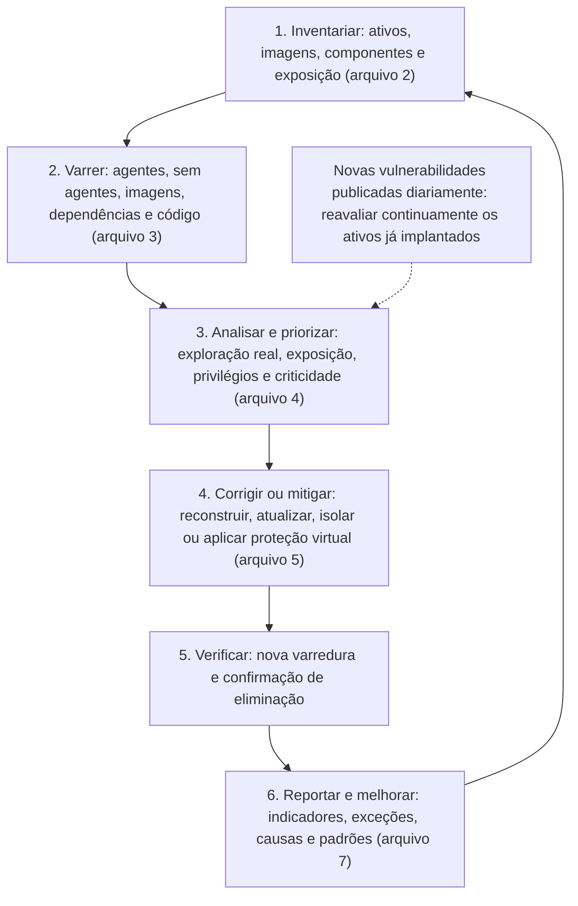

# Fundamentos de Gestão de Vulnerabilidades em Nuvem

> **Objetivo pedagógico:** compreender o que é a gestão de vulnerabilidades em nuvem e como ela se distingue da gestão de postura e da gestão de patches; conhecer os padrões de identificação e de pontuação (CVE, CWE, CVSS, EPSS, KEV e SSVC), de inventário de componentes (SBOM) e de comunicação de exploração (VEX); distinguir os tipos de vulnerabilidades em nuvem; entender a responsabilidade compartilhada; e aplicar o ciclo de vida do programa (inventariar, varrer, priorizar, corrigir, verificar e reportar).

## 1. Conceitos

| Conceito | Definição | Exemplo em nuvem |
|---|---|---|
| Vulnerabilidade | Fraqueza em software, firmware, componente ou serviço que pode ser explorada para comprometer a segurança | Falha de execução remota de código em uma biblioteca usada por uma aplicação |
| Má configuração | Configuração insegura de um recurso, que expõe ou enfraquece a proteção | Armazenamento com acesso público (tratada na gestão de postura, pasta 17) |
| Fraqueza (*weakness*) | Tipo de falha de desenho ou de implementação (classe) | Validação de entrada inadequada (CWE) |
| Exposição | Condição que torna uma vulnerabilidade alcançável por um atacante | Serviço vulnerável acessível pela internet |
| Exploração | Uso efetivo de uma vulnerabilidade em ataques | Código de exploração público; ataques observados |
| Correção (*remediation*) | Eliminação da vulnerabilidade | Atualizar a biblioteca; reconstruir a imagem |
| Mitigação | Redução do risco sem eliminar a vulnerabilidade | Regra de WAF; isolamento de rede; desabilitar um recurso |
| Risco de vulnerabilidade | Combinação de probabilidade de exploração e de impacto no contexto do ativo | Vulnerabilidade crítica em um serviço interno sem acesso a dados: risco moderado |
| *Zero-day* | Vulnerabilidade explorada antes da existência de correção pública | Falha ainda sem patch, com ataques ativos |

### Vulnerabilidade, configuração e postura

| Disciplina | Foco | Pasta |
|---|---|---|
| Gestão de vulnerabilidades | Falhas em **software e componentes** (CVEs) e seus ativos | Esta pasta |
| Gestão de postura (CSPM) | **Configurações** de contas, de redes, de identidade e de serviços | 17 |
| Testes de intrusão e avaliações | Verificação ativa e autorizada de explorabilidade | 16 |
| Proteção de cargas de trabalho | Proteção em tempo de execução | 18 |
| Gestão de patches | Processo de **aplicação de correções** (parte da correção) | Arquivo 5 |

As fronteiras se cruzam (por exemplo, uma imagem de contêiner com um pacote vulnerável e uma configuração insegura), e muitas ferramentas oferecem as duas funções. Mantenha **processos e donos claros** para evitar lacunas.

## 2. Padrões essenciais

### 2.1 Identificação e classificação

| Padrão | Descrição |
|---|---|
| CVE (Common Vulnerabilities and Exposures) | Identificador único de vulnerabilidades públicas (por exemplo, CVE-2021-44228) |
| CWE (Common Weakness Enumeration) | Catálogo de tipos de fraquezas de software (por exemplo, CWE-79, scripts entre sites) |
| CPE e PURL | Identificação de produtos (CPE) e de pacotes de software (Package URL, usado em SBOM e em varreduras de dependências) |
| NVD (National Vulnerability Database, do NIST) | Base de dados com os CVEs enriquecidos (pontuações e produtos afetados); atenção a atrasos de enriquecimento: use outras fontes em conjunto |
| OSV e bases de avisos de segurança (por exemplo, as de ecossistemas de pacotes) | Bases abertas de vulnerabilidades de código aberto, com dados por pacote e por versão |
| Avisos de fornecedores e de provedores | Boletins de segurança do fabricante e do provedor de nuvem: fonte primária para correções e mitigações |

### 2.2 Pontuação e probabilidade de exploração

| Padrão | O que mede | Observações |
|---|---|---|
| CVSS (FIRST) | **Gravidade técnica** de uma vulnerabilidade | Não mede o risco no seu contexto. A versão 4.0 (2023) separa os grupos Base, Ameaça, Ambiental e Suplementar |
| EPSS (FIRST) | **Probabilidade** de exploração observada nos próximos 30 dias | Estimativa estatística, atualizada diariamente |
| KEV (CISA) | Lista de vulnerabilidades **comprovadamente exploradas** em ataques reais | Sinal forte de prioridade; criada pela diretiva operacional BOD 22-01 |
| SSVC (CISA e Carnegie Mellon) | Árvore de decisão com ações (acompanhar, acompanhar com atenção, atender e agir) baseada em contexto | Método de decisão em vez de pontuação |
| Existência de código de exploração | Disponibilidade pública de exploits | Aumenta a probabilidade |

### 2.3 Inventário de componentes e comunicação de exploração

| Padrão | Descrição |
|---|---|
| SBOM (lista de materiais de software) | Inventário dos componentes de um software, nos formatos SPDX (ISO/IEC 5962) e CycloneDX |
| VEX (Vulnerability Exploitability eXchange) | Declaração de que uma vulnerabilidade **afeta ou não** um produto específico (estados: não afetado, afetado, corrigido e em investigação), usada para reduzir ruído |
| Formatos de VEX | CycloneDX VEX, OpenVEX e CSAF |

## 3. Tipos de vulnerabilidades em nuvem

| Tipo | Origem | Quem corrige | Ferramenta típica |
|---|---|---|---|
| Sistema operacional e pacotes de máquinas virtuais | Pacotes desatualizados | Cliente (IaaS) | Varredura de hosts, gestão de patches |
| Imagens de contêineres | Imagem-base, pacotes do sistema e dependências | Cliente | Varredura de imagens e de registros |
| Dependências de aplicações (bibliotecas de terceiros) | Pacotes de linguagens e transitivos | Cliente (equipes de desenvolvimento) | Análise de composição de software (SCA) |
| Código da própria aplicação | Falhas de desenho e de implementação | Cliente | Análise estática (SAST) e dinâmica (DAST), revisões |
| Infraestrutura como código | Modelos que criam recursos inseguros | Cliente | Varredura de IaC (e postura) |
| Componentes de Kubernetes | Plano de dados (nós, tempo de execução) e versões do cluster | Cliente (nós) e provedor (plano de controle gerenciado) | Varredura de nós e de clusters |
| Funções sem servidor | Dependências e camadas; versões de ambientes de execução em fim de vida | Cliente | Varredura de funções e de camadas |
| Serviços gerenciados (bancos, filas e outros) | Versões do motor e correções do serviço | Provedor (plataforma) e cliente (versões e janelas) | Avisos do provedor e inventário de versões |
| Equipamentos e dispositivos virtuais de terceiros | Firmware e software de fabricantes | Cliente e fabricante | Avisos e varreduras |
| Exposição de serviços e portas | Serviços vulneráveis alcançáveis da internet | Cliente | Mapeamento da superfície externa (pasta 13, arquivo 6) |
| Credenciais e segredos fracos ou expostos | Chaves em repositórios; senhas padrão | Cliente | Varredura de segredos (pasta 21) |

## 4. Responsabilidade compartilhada

| Camada | Provedor | Cliente |
|---|---|---|
| Hardware, hipervisor e infraestrutura física | Corrige | Não |
| Serviços totalmente gerenciados (por exemplo, armazenamento de objetos e filas) | Corrige a plataforma | Configura e usa corretamente |
| Plano de controle de serviços gerenciados de contêineres | Corrige | Atualiza as versões dentro das janelas oferecidas |
| Bancos de dados gerenciados | Corrige a plataforma e oferece atualizações de versões menores | Escolhe versões, janelas e atualizações de versões maiores; gerencia fim de vida |
| Máquinas virtuais (IaaS) | Fornece imagens de base | Mantém o sistema operacional, os pacotes e as aplicações |
| Contêineres e nós de clusters | Fornece o serviço de cluster | Mantém as imagens, os nós (quando aplicável) e as aplicações |
| Funções sem servidor | Corrige o ambiente de execução (e anuncia o fim de vida) | Atualiza o código, as dependências, as camadas e a versão do ambiente de execução |
| Aplicações e dependências | Não | Sempre do cliente |

**Pontos de atenção:** o provedor **informa** vulnerabilidades da plataforma por boletins, mas o cliente decide **quando** atualizar versões e imagens, e é o único responsável por seu código e por suas dependências (pasta 02).

## 5. Ciclo de vida do programa

| Etapa | Entregáveis |
|---|---|
| Inventariar | Inventário de ativos e de componentes (SBOM), com dono, criticidade, exposição e ambiente |
| Varrer | Resultados de varredura com cobertura medida |
| Priorizar | Lista de vulnerabilidades por prioridade, com contexto |
| Corrigir ou mitigar | Ações com responsáveis e prazos; mudanças implantadas |
| Verificar | Evidência de eliminação ou de mitigação |
| Reportar e melhorar | Indicadores, exceções, análise de causa raiz e ajustes de padrões |

## 6. O que a nuvem muda

| Aspecto | Efeito |
|---|---|
| Ativos efêmeros e escaláveis | Um ativo pode existir por minutos: a varredura deve acontecer na **construção** (imagem e código) e continuamente em **execução** |
| Imagens como unidade de implantação | Uma imagem vulnerável é replicada em centenas de instâncias; corrigir a imagem corrige todas |
| Automação e infraestrutura como código | A correção pode ser um *pull request*: reconstruir e reimplantar |
| Novas vulnerabilidades em ativos antigos | Uma imagem "limpa" na construção pode se tornar vulnerável quando um novo CVE é publicado: a **reavaliação contínua** é obrigatória |
| Inventário por APIs | Descobrir ativos é mais fácil, mas exige integração |
| Dependências profundas | Camadas de imagens e dependências transitivas ocultam componentes vulneráveis |
| Responsabilidade compartilhada | Muitas vulnerabilidades da plataforma não são acessíveis ao cliente: depender de avisos e de versões |
| Exposição mais clara ou mais oculta | Regras de rede e de identidade determinam a alcançabilidade |
| Velocidade da exploração | Vulnerabilidades críticas são exploradas em horas ou dias após a divulgação |

## 7. Exemplo prático: do CVE ao risco no contexto

Considere a divulgação de uma vulnerabilidade crítica de execução remota de código em uma biblioteca amplamente usada, como a do caso público CVE-2021-44228.

| Pergunta | Fonte de resposta |
|---|---|
| Quais ativos usam a biblioteca? | Inventário de componentes (SBOM) e varreduras de imagens, hosts e dependências |
| Quais estão expostos à internet? | Inventário de nuvem e mapeamento de exposição |
| Há exploração ativa? | KEV, inteligência de ameaças e EPSS |
| Qual o impacto se explorada em cada ativo? | Privilégios da identidade da carga, classificação dos dados acessíveis e raio de impacto |
| Há mitigação imediata? | Regras de WAF, parâmetros de configuração, isolamento de rede |
| Há correção? | Aviso do fornecedor; versão corrigida; nova imagem |
| Como saberemos que foi corrigido? | Nova varredura; VEX para componentes não afetados |
| Há sinais de exploração já ocorrida? | Detecções e registros (pasta 13) |

## 8. Casos de uso corporativos

- Definição do programa de gestão de vulnerabilidades de nuvem, com papéis, padrões e indicadores.
- Integração da varredura ao pipeline de entrega e aos registros de contêineres.
- Resposta rápida a vulnerabilidades críticas com base no inventário de componentes.

## 9. Normas e frameworks relevantes

- NIST SP 800-40 Rev. 4 (planejamento de gestão de patches empresariais); NIST SP 800-53 Rev. 5 (RA-5, varredura de vulnerabilidades; SI-2, correção de falhas); NIST SP 800-218 (SSDF, PW.4 e RV)
- ISO/IEC 27002:2022 (8.8, gestão de vulnerabilidades técnicas; 8.19, instalação de software); ISO/IEC 29147 e 30111 (divulgação e tratamento de vulnerabilidades)
- CIS Controls v8.1 (controle 7, gestão contínua de vulnerabilidades); CSA CCM v4 (TVM); PCI DSS v4.0.1 (requisitos 6.3 e 11.3)
- CISA KEV e BOD 22-01; FIRST CVSS v4.0 e EPSS; SSVC

## 10. Checklist operacional: base da gestão de vulnerabilidades

- [ ] Programa aprovado, com escopo, papéis, política e indicadores
- [ ] Responsabilidade por camada e por serviço definida (provedor, compartilhada ou cliente)
- [ ] Padrões adotados (CVE, CVSS, EPSS, KEV, SSVC, SBOM e VEX) e fontes de dados definidas
- [ ] Diferença e integração entre gestão de vulnerabilidades, de postura e de patches definida
- [ ] Ciclo de vida do programa documentado, com responsáveis e prazos
- [ ] Reavaliação contínua dos ativos implantados diante de novos CVEs
- [ ] Revisão anual do programa

## 11. Referências

- Souppaya, M.; Scarfone, K. NIST SP 800-40 Rev. 4. 2022.
- FIRST. Common Vulnerability Scoring System v4.0: Specification Document. 2023.
- CISA. Binding Operational Directive 22-01 e Known Exploited Vulnerabilities Catalog.
- MITRE. CVE Program e CWE (documentação).
- ISO/IEC 27002:2022, controle 8.8.
- Pastas 02, 12 e 17 deste repositório.
