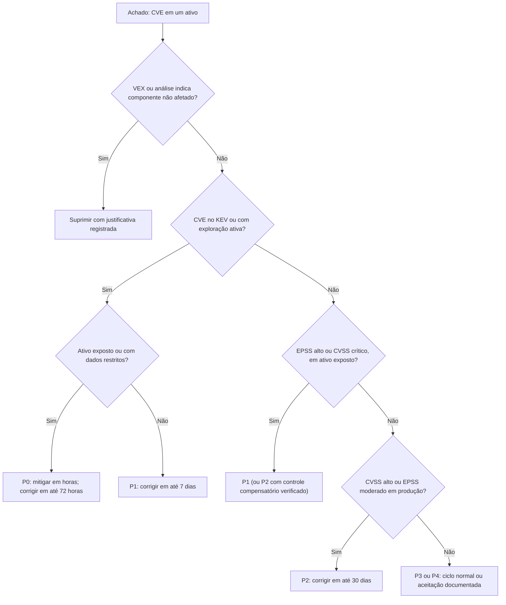

# Priorização Baseada em Risco: CVSS, EPSS, KEV e SSVC

> **Objetivo pedagógico:** priorizar vulnerabilidades por **risco real** e não apenas por gravidade técnica: compreender o que o CVSS (versões 3.1 e 4.0) mede e o que não mede, usar o EPSS (probabilidade de exploração), o catálogo KEV da CISA (exploração comprovada) e a árvore de decisão SSVC, incorporar o contexto de nuvem (exposição, privilégios da carga, dados acessíveis, controles compensatórios e criticidade), usar VEX para eliminar ruído, definir prioridades e prazos, e implementar um cálculo transparente de prioridade em Python e em consultas.

## 1. O problema da priorização por gravidade

| Fato | Consequência |
|---|---|
| Dezenas de milhares de CVEs são publicados por ano, e os scanners listam milhares de achados | Impossível corrigir tudo ao mesmo tempo |
| Uma fração pequena dos CVEs é explorada em ataques reais | Corrigir por gravidade desperdiça esforço em vulnerabilidades improváveis |
| O CVSS Base mede gravidade técnica, **não o risco no seu ambiente** | Uma vulnerabilidade "crítica" em um serviço isolado pode ser menos urgente que uma "média" explorada e exposta |
| Atacantes exploram vulnerabilidades em horas ou em dias | Vulnerabilidades exploradas e expostas exigem ação imediata |
| Equipes têm capacidade limitada | Priorizar é necessário e deve ser transparente |

## 2. CVSS

| Versão | Características |
|---|---|
| CVSS v3.1 | Métricas Base (explorabilidade e impacto), Temporais e Ambientais; pontuação de 0,0 a 10,0 |
| CVSS v4.0 (2023) | Grupos de métricas **Base, Ameaça (Threat), Ambiental (Environmental) e Suplementar**; nomenclatura: CVSS-B (somente Base), CVSS-BT (Base e Ameaça), CVSS-BE (Base e Ambiental) e CVSS-BTE (todos); novas métricas, como requisitos de ataque e interação do usuário mais granular |

| Faixa de gravidade | Pontuação |
|---|---|
| Nenhuma | 0,0 |
| Baixa | 0,1 a 3,9 |
| Média | 4,0 a 6,9 |
| Alta | 7,0 a 8,9 |
| Crítica | 9,0 a 10,0 |

### O que o CVSS faz bem e mal

| Faz bem | Limitações |
|---|---|
| Linguagem comum para descrever características técnicas (vetor de ataque, complexidade, privilégios, impacto) | A pontuação Base ignora exploração real, exposição e contexto |
| Permite ajustes ambientais (importância do ativo, controles) | Poucas organizações preenchem as métricas Ambientais |
| Amplamente suportado por ferramentas | Valores atribuídos por diferentes fontes (fornecedor e NVD) podem divergir |

**Uso recomendado:** CVSS como **um dos insumos** (gravidade técnica), e nunca como único critério. Prefira as pontuações com métricas de **Ameaça** (CVSS-BT) quando disponíveis.

## 3. EPSS (Exploit Prediction Scoring System)

| Aspecto | Descrição |
|---|---|
| O que é | Modelo estatístico mantido pelo FIRST que estima a **probabilidade de um CVE ser explorado nos próximos 30 dias** |
| Saída | Probabilidade (de 0 a 1) e percentil (posição relativa entre todos os CVEs) |
| Uso | Priorizar entre vulnerabilidades de mesma gravidade; identificar aquelas com maior probabilidade de exploração |
| Atualização | Diária; a versão do modelo evolui (confirme a versão vigente) |
| Limitações | É probabilidade genérica (não considera seu contexto); CVEs recém-divulgados podem ter dados limitados |

Consulta pública (somente leitura):

```bash
# Consultar o EPSS de um CVE pela API pública do FIRST (exemplo: CVE-2021-44228)
curl -s "https://api.first.org/data/v1/epss?cve=CVE-2021-44228"
```

## 4. Catálogo KEV da CISA

| Aspecto | Descrição |
|---|---|
| O que é | Lista, mantida pela CISA, de vulnerabilidades **com evidência de exploração em ataques reais** |
| Origem | Diretiva Operacional Vinculante BOD 22-01 (2021), que obriga as agências federais dos EUA a corrigir as vulnerabilidades listadas em prazos definidos |
| Valor | Sinal **forte** de prioridade: a exploração é comprovada, e os atacantes já a usam |
| Conteúdo | Identificador do CVE, produto, data de inclusão, ação requerida e prazo, e indicação de uso em campanhas de *ransomware* |
| Limitações | Não é exaustiva: vulnerabilidades exploradas e não catalogadas existem; foca em produtos amplamente usados |
| Uso | Qualquer ocorrência de um CVE do KEV em seu ambiente, especialmente exposta, é de **prioridade máxima** |

```bash
# Baixar o catálogo KEV (JSON público) e listar quantos CVEs ele contém (requer o utilitário jq)
curl -s "https://www.cisa.gov/sites/default/files/feeds/known_exploited_vulnerabilities.json" -o kev.json
jq '.vulnerabilities | length' kev.json
# Verificar se um CVE está no catálogo
jq -r '.vulnerabilities[] | select(.cveID=="CVE-2021-44228") | [.cveID,.vendorProject,.product,.dateAdded,.dueDate] | @tsv' kev.json
```

## 5. SSVC (Stakeholder-Specific Vulnerability Categorization)

O SSVC, da CISA e da Carnegie Mellon, é uma **árvore de decisão** que leva a uma ação, considerando o contexto do tomador de decisão.

| Ponto de decisão | Perguntas | Valores típicos |
|---|---|---|
| Estado da exploração | Há exploração ativa, código público de prova de conceito, ou nada? | Nenhuma, prova de conceito, ativa |
| Automatizável | O ataque pode ser automatizado em escala? | Sim ou não |
| Impacto técnico | A exploração dá controle total ou apenas exposição parcial? | Parcial ou total |
| Exposição do sistema | O sistema está exposto à internet, acessível a uma rede pequena ou fechado? | Aberto, pequeno ou controlado |
| Impacto na missão e no bem-estar | Qual o impacto no negócio e nas pessoas? | Baixo, médio ou alto |

| Decisão (ação) | Significado | Resposta típica |
|---|---|---|
| Acompanhar (*Track*) | Sem ação imediata | Corrigir no ciclo normal |
| Acompanhar com atenção (*Track\**) | Monitoramento mais próximo | Corrigir no próximo ciclo; revisar se a situação mudar |
| Atender (*Attend*) | Requer atenção de equipes de segurança e de operações | Corrigir em prazo curto; supervisão da gestão |
| Agir (*Act*) | Ação imediata, com envolvimento da liderança | Correção ou mitigação emergencial |

O SSVC torna explícito **por que** uma vulnerabilidade tem determinada prioridade e se adapta ao contexto da organização.

## 6. Contexto de nuvem: o que muda a prioridade

| Fator de contexto | Efeito na prioridade | Fonte |
|---|---|---|
| Exposição à internet e alcançabilidade do componente vulnerável | Aumenta fortemente | Inventário de rede e de exposição (arquivo 2) |
| Privilégios da identidade da carga (permissões na nuvem) | Aumenta o impacto se a carga puder acessar dados e serviços críticos | Papéis e permissões efetivas (pasta 06) |
| Dados acessíveis e sua classificação | Aumenta o impacto com dados restritos | Catálogo de dados (pasta 09) |
| Criticidade do serviço e do ambiente | Produção e serviços críticos têm prioridade | Etiquetas e inventário |
| Controles compensatórios (WAF, segmentação e EDR) | Reduzem a probabilidade, **se verificados** | Pasta 12 |
| Alcançabilidade do código vulnerável | Reduz se o código vulnerável não é carregado ou chamado | Análise de alcançabilidade e VEX |
| Existência de correção ou de mitigação | Define a ação (corrigir, mitigar ou aceitar) | Avisos do fornecedor |
| Possibilidade de movimentação lateral e de escalonamento | Aumenta o impacto | Arquitetura e segmentação |
| Exploração ativa no setor | Aumenta | Inteligência de ameaças (pasta 13) |

## 7. VEX: eliminar o ruído de vulnerabilidades não aplicáveis

| Estado VEX | Significado | Ação |
|---|---|---|
| Não afetado (*not affected*) | O produto contém o componente, mas a vulnerabilidade não é explorável (por exemplo, o código vulnerável não é usado) | Suprimir o achado, com justificativa |
| Afetado (*affected*) | O produto é vulnerável | Tratar conforme a prioridade |
| Corrigido (*fixed*) | Versões que contêm a correção | Verificar a implantação |
| Em investigação (*under investigation*) | Análise em andamento | Monitorar |

Fornecedores e comunidades publicam declarações VEX (formatos CycloneDX, OpenVEX e CSAF). Equipes internas também podem produzir VEX para **seus** componentes, registrando por que um achado não se aplica.

## 8. Modelo de prioridade (exemplo)

| Prioridade | Critérios (exemplo) | Resposta |
|---|---|---|
| P0 (emergencial) | CVE no KEV (ou exploração ativa conhecida) **e** ativo exposto à internet ou com acesso a dados restritos | Mitigação imediata (horas) e correção em até 72 horas |
| P1 (crítica) | KEV em ativo interno; ou EPSS alto (por exemplo, ≥ 0,5) em ativo exposto; ou CVSS ≥ 9,0 em ativo exposto e crítico | Correção em até 7 dias |
| P2 (alta) | CVSS ≥ 7,0 ou EPSS moderado em ativos de produção; sem exposição direta | Correção em até 30 dias |
| P3 (média) | CVSS 4,0 a 6,9; ativos internos ou de menor criticidade | Correção em até 90 dias |
| P4 (baixa) | CVSS < 4,0; componentes não alcançáveis; ambientes isolados | Próximo ciclo de manutenção ou aceitação documentada |

Os limiares são **exemplos**: ajuste-os ao apetite de risco, à capacidade da equipe e às exigências (por exemplo, normas setoriais). **Documente** o modelo e **meça** se ele reduz de fato o risco (arquivo 7).

## 9. Cálculo transparente de prioridade em Python

`achados.csv` (fictício):

```
id,cve,ativo,cvss,epss,kev,exposto_internet,dados_restritos,controle_compensatorio_verificado,vex_nao_afetado
F-001,CVE-2021-44228,vm-api-prod-01,10.0,0.97,sim,sim,sim,nao,nao
F-002,CVE-2023-00001,img-relatorios:2.1,9.8,0.02,nao,nao,sim,nao,nao
F-003,CVE-2023-00002,fn-pdf-gerador,7.5,0.04,nao,nao,nao,sim,nao
F-004,CVE-2022-00003,vm-batch-02,5.3,0.01,nao,nao,nao,nao,sim
F-005,CVE-2024-00004,img-extratos:4.2,8.1,0.62,nao,sim,sim,sim,nao
```

```python
# Cálculo de prioridade a partir de CVSS, EPSS, KEV e contexto (modelo ilustrativo, ajustável à política da organização)
import csv

def prioridade(cvss: float, epss: float, kev: bool, exposto: bool, dados_restritos: bool,
               controle_verificado: bool, vex_nao_afetado: bool) -> tuple[str, str]:
    if vex_nao_afetado:
        return "P4", "VEX: nao afetado (registrar justificativa)"
    if kev and (exposto or dados_restritos):
        return "P0", "KEV com exposicao ou dados restritos"
    if kev:
        return "P1", "KEV em ativo interno"
    if exposto and (epss >= 0.5 or cvss >= 9.0):
        # Controle compensatório verificado reduz um nível, nunca abaixo de P2
        return ("P2", "exposto com controle compensatorio verificado") if controle_verificado else ("P1", "exposto com EPSS alto ou CVSS critico")
    if cvss >= 7.0 or epss >= 0.2:
        return "P2", "gravidade alta ou EPSS moderado"
    if cvss >= 4.0:
        return "P3", "gravidade media"
    return "P4", "gravidade baixa"

def executar(caminho: str) -> None:
    with open(caminho, newline="", encoding="utf-8") as f:
        for linha in csv.DictReader(f):
            p, motivo = prioridade(
                cvss=float(linha["cvss"]), epss=float(linha["epss"]),
                kev=linha["kev"] == "sim", exposto=linha["exposto_internet"] == "sim",
                dados_restritos=linha["dados_restritos"] == "sim",
                controle_verificado=linha["controle_compensatorio_verificado"] == "sim",
                vex_nao_afetado=linha["vex_nao_afetado"] == "sim",
            )
            print(f'{linha["id"]:6} {linha["cve"]:16} {linha["ativo"]:22} {p}  {motivo}')

if __name__ == "__main__":
    executar("achados.csv")
```

O modelo é **ilustrativo**: o importante é que seja **explícito, auditável e revisado**. Registre a prioridade e o **motivo** em cada achado, para que equipes e auditores entendam as decisões.



## 10. Exemplo prático: de 41 mil achados a 380 prioritários

| Etapa | Resultado |
|---|---|
| Achados brutos de varreduras | 41.200 em 3.400 ativos |
| Remoção de duplicatas e consolidação por imagem e por componente | 12.900 achados únicos |
| Supressão por VEX e por alcançabilidade (componentes não carregados) | 4.100 suprimidos com justificativa |
| Aplicação de KEV, EPSS e contexto | 3 em P0 (todos KEV e expostos), 46 em P1, 331 em P2 e o restante em P3 e P4 |
| Ação | P0 mitigados em 6 horas (regras de proteção) e corrigidos em 36 horas; P1 corrigidos em 5 dias; P2 em janelas de 30 dias, em grande parte por reconstrução de imagens-base |
| Resultado | 380 vulnerabilidades prioritárias tratadas em lugar de 41 mil; tempo mediano de correção de P0 e P1 de 11 dias para 3 dias; nenhum incidente por vulnerabilidades conhecidas no período | |

## 11. Casos de uso corporativos

- Política de priorização documentada, com critérios de KEV, EPSS, CVSS, exposição e criticidade.
- Painel de vulnerabilidades por prioridade, por equipe e por prazo.
- Processo de VEX interno para registrar achados não aplicáveis.

## 12. Normas e frameworks relevantes

- FIRST CVSS v3.1 e v4.0; FIRST EPSS; CISA KEV e BOD 22-01; CISA e Carnegie Mellon, SSVC
- NIST SP 800-40 Rev. 4 (priorização e prazos de patches); NIST SP 800-30 Rev. 1 (avaliação de riscos); ISO/IEC 27005:2022
- CISA. Minimum Requirements for VEX; CycloneDX VEX, OpenVEX e CSAF; ISO/IEC 27002:2022 (8.8)

## 13. Checklist operacional: priorização

- [ ] Modelo de priorização documentado e aprovado (insumos, critérios, prioridades e prazos)
- [ ] CVSS usado como insumo (preferindo métricas de ameaça), junto com EPSS, KEV e contexto
- [ ] Catálogo KEV monitorado automaticamente e cruzado com o inventário
- [ ] Contexto de nuvem incorporado (exposição, privilégios, dados, criticidade e controles verificados)
- [ ] VEX e análise de alcançabilidade para suprimir achados não aplicáveis, com justificativa
- [ ] Prioridade e motivo registrados em cada achado
- [ ] Eficácia do modelo medida (incidentes, tempo de exposição de P0 e P1) e modelo revisado semestralmente
- [ ] Processo emergencial para P0 definido e testado

## 14. Referências

- FIRST. CVSS v4.0: Specification Document. 2023; EPSS: Exploit Prediction Scoring System (documentação e API).
- CISA. Known Exploited Vulnerabilities Catalog; BOD 22-01. 2021.
- Spring, J. et al. Prioritizing Vulnerability Response: A Stakeholder-Specific Vulnerability Categorization (SSVC). Carnegie Mellon University SEI e CISA.
- CISA. Minimum Requirements for Vulnerability Exploitability eXchange (VEX). 2023.
- Pastas 04, 12 e 13 deste repositório.
